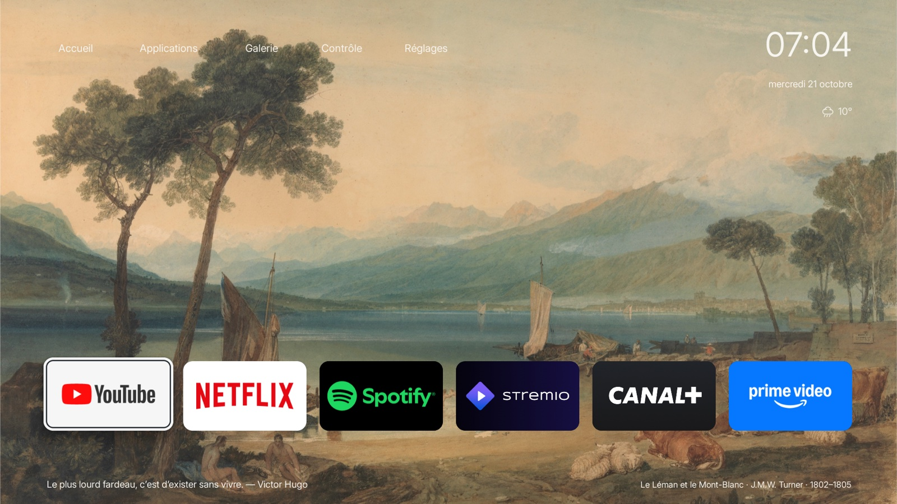

# Ambilight Art Launcher

An art-first Android TV launcher for **Philips Ambilight TVs**.

100 curated paintings, two home styles, an art screensaver, quotes, weather and Spotify controls with synchronized lyrics when available. French interface, designed for the remote.

### Classic home



### CleanFrame home


<details>
<summary>More screenshots</summary>

### CleanFrame list


### Artwork details


### Art gallery


### Applications


### Control center


### Music focus with synchronized lyrics


Actual on-TV capture from v0.13.0, showing synced lyrics for RER D by Dajak.

### Art screensaver


</details>

### Build

App version **0.17.3** · Native Java, no Gradle. Toolchain setup targets macOS Apple Silicon:

```sh
python3 scripts/setup_toolchain.py
./build.sh
```

The APK is generated in `dist/`. Tested on Philips 65PUS8007/12 with Android TV 14. Spotify requires notification access; lyrics depend on LRCLIB availability. AirPlay requires an installed receiver app.

Inspired by [CleanFrame](https://github.com/nthnclrk/CleanFrame). [Credits and licenses](THIRD_PARTY_NOTICES.md) · artwork sources in the [catalog](app/src/main/assets/art/catalog.json).

Independent project; not affiliated with Philips or TP Vision.
