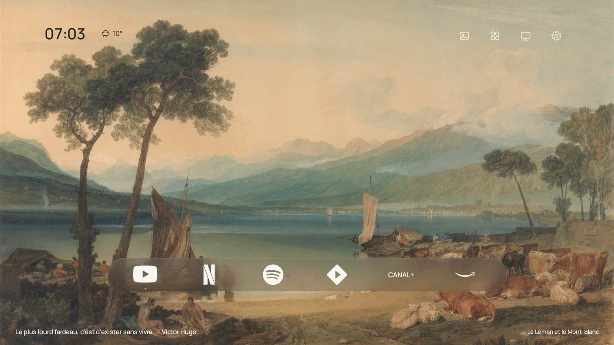
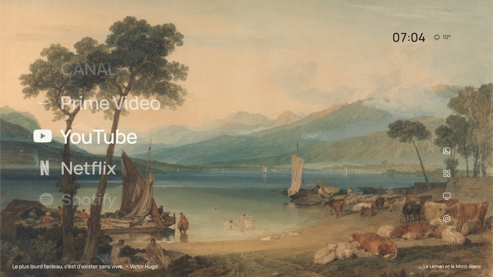
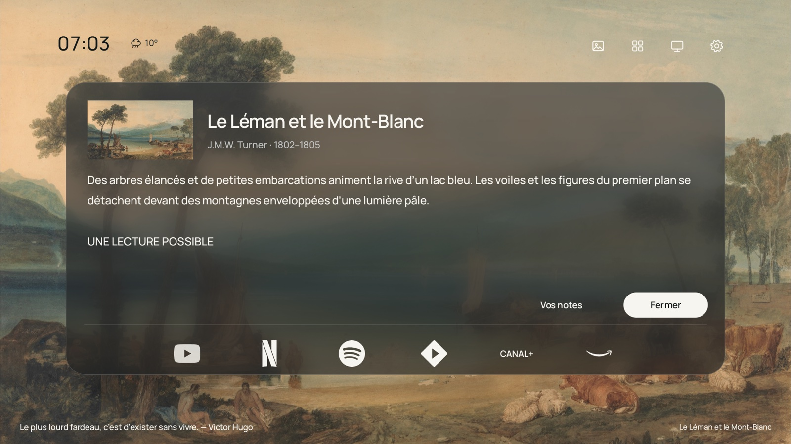
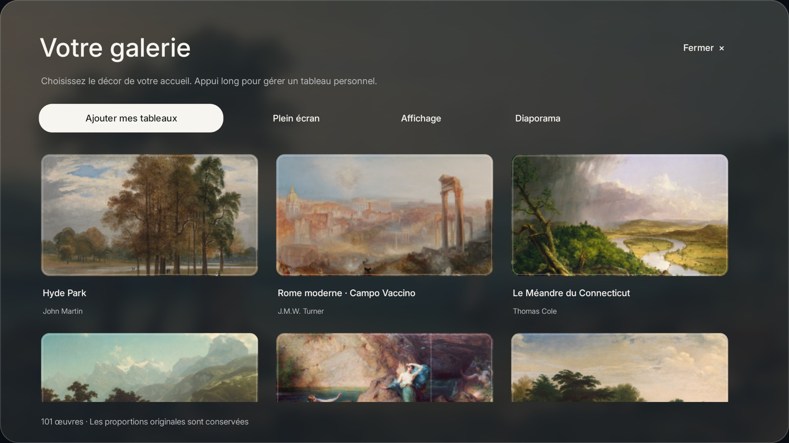
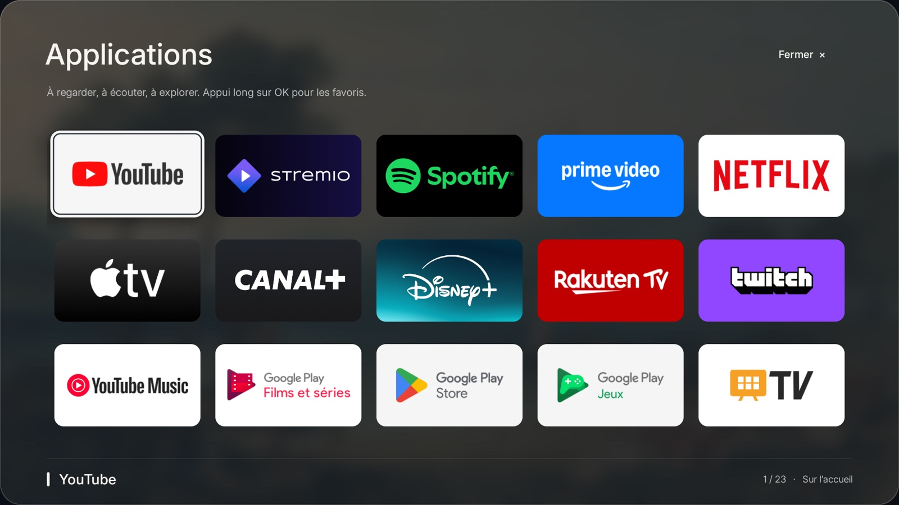
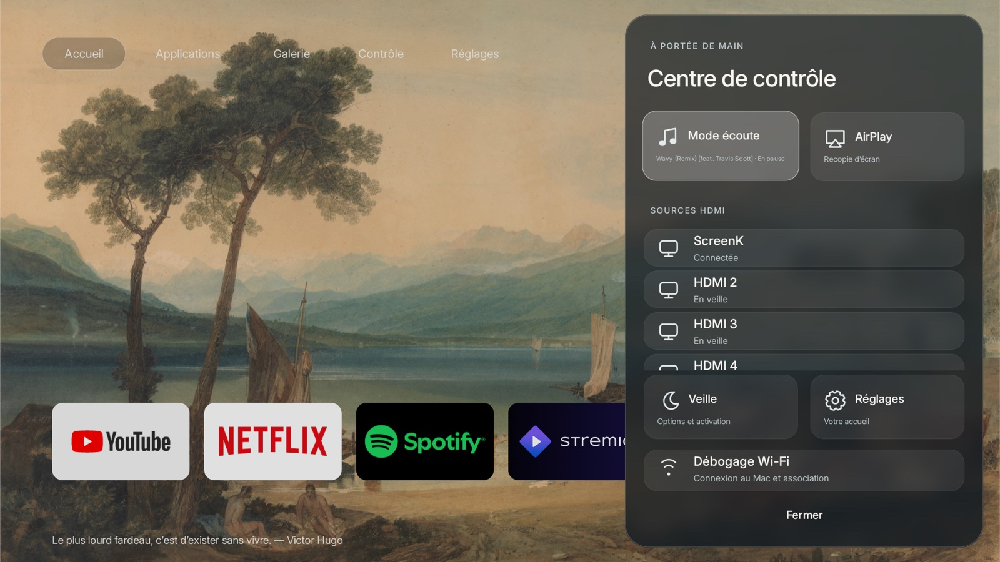
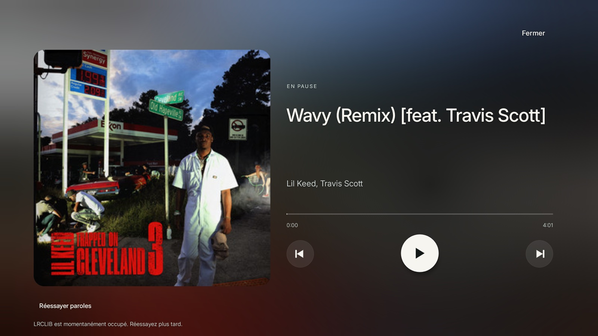
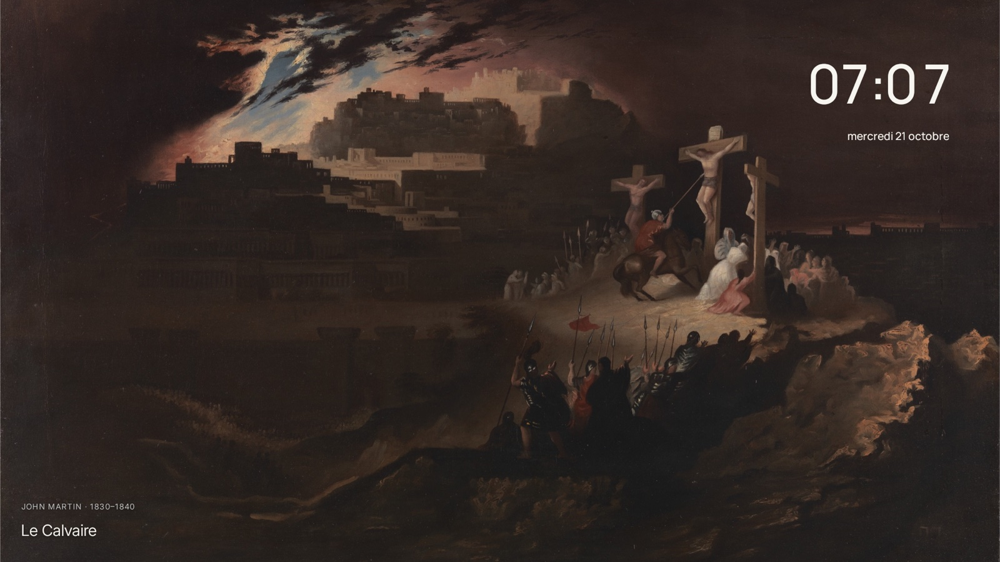

# Atelier TV

Un accueil Android TV qui laisse la place aux œuvres.

Deux thèmes, **Atelier** et **CleanFrame**, 100 tableaux, une veille artistique, des citations, la météo et un mode musique Spotify. Interface en français, pensée pour la télécommande.

### Atelier


### CleanFrame



<details>
<summary>Voir les autres écrans</summary>

### Liste CleanFrame



### Cartel de l’œuvre



### Galerie



### Applications



### Centre de contrôle



### Focus musique



### Veille



</details>

### Compiler

Version **0.17.3** · Java natif, sans Gradle. Préparation prévue pour macOS Apple Silicon :

```sh
python3 scripts/setup_toolchain.py
./build.sh
```

APK généré dans `dist/`. Testé sur Philips 65PUS8007/12, Android TV 14. Spotify nécessite l’accès aux notifications ; AirPlay dépend d’un récepteur installé sur la TV.

Inspiré de [CleanFrame](https://github.com/nthnclrk/CleanFrame). [Crédits et licences](THIRD_PARTY_NOTICES.md) · sources des œuvres dans [le catalogue](app/src/main/assets/art/catalog.json).
